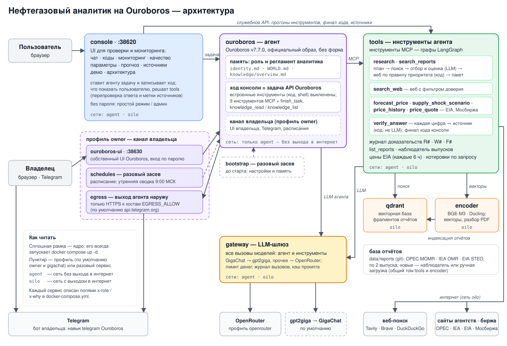

# Нефтегазовый аналитик на Ouroboros

AI-агент в роли **«Старший аналитик нефтегазового рынка»**. Он отвечает на отраслевые вопросы, прогнозирует цены
нефти расчётным модулем и ищет гибридно: основа ответа — отчёты OPEC / IEA / EIA, интернет — дополнение без жёлтой
прессы. Откуда каждая цифра, в ответе помечено явно.

- **Агент — [Ouroboros](https://github.com/razzant/ouroboros)** v7.7.0: официальный образ без форка, закреплённый
  коммит e41596c. Он ведёт диалог, решает, какие инструменты звать, и пишет ответ.
- **Инструменты агента — графы LangGraph** (сервис `tools`, по MCP): исследование отчётов с оценкой достаточности,
  веб-поиск с уровнями доверия, прогноз, сценарий, история цен, текущие котировки (Brent, WTI, газ Henry Hub и TTF), проверка цифр.
- **Качество держит код, а не обещание модели.** `research` всегда начинает с отчётов, а в веб идёт по правилу в коде;
  `search_web` без свежего пакета отчётов отклоняется. Каждую цифру ответа код сверяет с текстом источника, а метки
  источников ставит система — модель их не пишет.

| Документ | О чём |
|---|---|
| [docs/requirements.md](docs/requirements.md) | исходная постановка (ТЗ) |
| [docs/guide/how_it_works.md](docs/guide/how_it_works.md) | как агент отвечает — по шагам |
| [docs/architecture/DESIGN.md](docs/architecture/DESIGN.md) | архитектурные решения, особенности Ouroboros, данные, риски |
| [docs/guide/sources.md](docs/guide/sources.md) | источники: что подключено и как добавить новый |
| [docs/guide/owner.md](docs/guide/owner.md) | канал владельца: UI Ouroboros, Telegram, утренняя сводка |
| [docs/guide/operations.md](docs/guide/operations.md) | эксплуатация: готовность, логи, деньги, резервная копия, обновление, сбои |
| [docs/guide/parameters.md](docs/guide/parameters.md) | что делает каждый параметр и что будет при его изменении |
| [docs/report.md](docs/report.md) | отчёт: решения, качество, ограничения, что улучшить |
| [openspec/specs/](openspec/specs) | спеки поведения по возможностям — основа любой доработки ([как дорабатывать](#как-дорабатывать)) |
| [docs/adr/0001-ouroboros-as-agent.md](docs/adr/0001-ouroboros-as-agent.md) | почему Ouroboros + LangGraph |

## Быстрый старт

Пошагово, с проверкой и прогонами, — [INSTALL.md](INSTALL.md).

Нужны Docker с Compose v2, Python 3.10+ (только для `scripts/init_env.py`), ключ GigaChat API и выход в интернет
(образ Ouroboros собирается с GitHub, модели — с HuggingFace). Машина: от 16 ГБ памяти (сумма лимитов по умолчанию —
16,4 ГБ, из них ядро — 15,5 ГБ; лимит — потолок контейнера, а не обычный расход), ~25 ГБ диска (образы, модели
~4,8 ГБ, индекс), GPU не нужен.

```bash
python scripts/init_env.py     # .env из .env.example: внутренние токены генерируются сами
# впишите в .env GIGACHAT_CREDENTIALS (и TAVILY_API_KEY, TELEGRAM_BOT_TOKEN, если есть)
docker compose up -d           # ядро (агент, инструменты, шлюз, кодировщик, база, консоль) и профили owner, gigachat
```

Консоль — `http://127.0.0.1:38620`, без пароля: открывается в простом режиме (чат и прогноз), все вкладки — кнопкой
«Режим администратора» в шапке. UI Ouroboros (профиль owner) — `http://127.0.0.1:38630`, пароль `ouroboros`
(сменить — `OUROBOROS_PASSWORD` в `.env`, [operations.md](docs/guide/operations.md#7-обновление)). По шаблону `.env`
оба видны в сети сервера (`OILO_BIND=0.0.0.0`); в интернет пробрасывайте только порт консоли 38620. Готовность видна в
шапке консоли (индикатор здоровья) и в `docker compose ps`: все сервисы ядра `healthy`. Живой ход через агента — `docker compose exec console
oilo smoke` (GigaChat Freemium — бесплатно, на OpenRouter ~$0.01).

**Первый запуск** на CPU-сервере (12 ядер, кодировщику — 4): сборка образов ~15 мин, модели ~6 мин, база отчётов
~1,5 ч (EIA STEO, OPEC MOMR и IEA OMR по 2 выпуска). Агент отвечает и во время сборки базы — по готовым выпускам.
Без ключа и без базы можно посмотреть офлайн-демо — записанные ходы агента по шагам:
`python scripts/init_env.py && docker compose up -d --no-deps --build console`, затем кнопка «Режим администратора»
и вкладка «Демо».

По умолчанию (`.env.example`) включены оба профиля — `COMPOSE_PROFILES=owner,gigachat`:
- `gigachat` — модели GigaChat Сбера через прокси `gpt2giga` (LLM-профиль по умолчанию, Freemium бесплатен);
- `owner` — канал владельца: собственный UI Ouroboros, Telegram, утренняя сводка ([owner.md](docs/guide/owner.md)).

**Дополнительно** (всё — в `.env`):
- модели OpenRouter вместо GigaChat: `python scripts/llm_profile.py openrouter`, ключ `OPENROUTER_API_KEY`;
- без канала владельца: убрать `owner` из `COMPOSE_PROFILES` (останется `gpt2giga` — он нужен LLM-профилю gigachat);
  только ядро — пустой `COMPOSE_PROFILES` после `python scripts/llm_profile.py openrouter`: на gigachat без
  `gpt2giga` у шлюза нет модели;
- хост без прямого выхода в интернет: `COMPOSE_FILE=docker-compose.yml:deploy/compose/proxy.yml`,
  `OUTBOUND_PROXY=http://proxy:3128` и `UPSTREAM_PROXY` (см. шапку `deploy/compose/proxy.yml`);
- выкладка на сервер по ssh: `python scripts/deploy.py up` (цель — `DEPLOY_SSH` и `DEPLOY_DIR` в `.env`).

## Примеры запросов

Спросить можно в чате консоли, в UI Ouroboros, в Telegram или из командной строки:
`docker compose exec console oilo ask "Спрогнозируй цену Brent на 3 месяца"`.

| Тип | Пример вопроса | Что делает агент |
|---|---|---|
| По отчётам | Сравни прогнозы изменения мирового спроса на нефть в 2026 году от OPEC и IEA. | `research` по базе, метки `[Отчёт OPEC MOMR, октябрь 2026, с. 42]` |
| Веб (свежее) | Какие последние новости о решениях ОПЕК+ по добыче на этой неделе? | `research` → веб по правилу свежести, метки `[Источник: rigzone.com, web, 2026-10-16, уровень 2]` |
| Комбинированный | Что EIA прогнозирует по цене Brent до конца 2026 года и какие свежие события могут изменить прогноз? | отчёт EIA + веб + расчёт, каждый источник помечен |
| Прогноз | Спрогнозируй цену Brent на 3 месяца. | `forecast_price`: медиана, интервалы 50/80/95%, сравнение с random walk |
| Сценарий | Оцени диапазон цены Brent при сокращении добычи ОПЕК+ на 2 млн б/с. | `supply_shock_scenario` поверх базового прогноза |
| История цен | Как менялась цена WTI с начала 2026 года? | `price_history` по рядам EIA |
| Текущая цена | Сколько сейчас стоит нефть Brent? Какая сейчас цена газа Henry Hub? | `price_quote(benchmark)`: фьючерс ближайшего месяца на Мосбирже с единицей и временем сделки, рядом спот EIA с датой |
| Уточнение | «Спрогнозируй Brent на 3 месяца» → «А WTI?» | понимает вопрос с учётом диалога |
| На английском | What does the latest IEA report say about oil demand in 2026? | ответ и метки на английском |
| Вне компетенции | Посоветуй рецепт борща. | вежливый отказ без инструментов |
| Личный инвестсовет | Купить ли мне акции Роснефти? | без персональной рекомендации, с рыночным контекстом |

Полные ответы с ходом агента, ценой и временем — [docs/demo_dialogs.md](docs/demo_dialogs.md) и вкладка «Демо».

## Архитектура



| Сервис | Что делает | Почему отдельно |
|---|---|---|
| `ouroboros` | агент: рассуждение, выбор инструментов, ответ; роль и регламент — в его памяти | основа решения; сеть без выхода в интернет — у агента есть код и shell |
| `tools` | инструменты по MCP — графы LangGraph; журнал доказательств; финал хода консоли; наблюдатель выпусков; цены EIA и котировки Мосбиржи | читает недоверенный веб и не знает ни пароля агента, ни ключа LLM |
| `gateway` | LLM-шлюз: все вызовы моделей, ключ провайдера, жёсткий лимит денег, журнал, кэш промпта (модели `anthropic/*`); модели `GigaChat-*` — в `gpt2giga` | агент без выхода в интернет доходит до модели только через него |
| `encoder` | модели BGE-M3 и Docling: векторы, разбор PDF, индексация отчётов | модели весят ~5 ГБ — грузятся один раз, `tools` остаётся лёгким |
| `qdrant` | векторная база фрагментов отчётов | готовая БД, индекс в своём томе |
| `console` | UI: чат, демо, ходы, мониторинг, качество, параметры, прогноз, источники, архитектура; без паролей: простой режим (чат и прогноз) и режим администратора (всё) | простой UI по требованиям |
| `bootstrap` | разовый засев настроек и памяти агента до его старта | Ouroboros читает их при старте |
| профиль `gigachat` | `gpt2giga` — прокси GigaChat: формат OpenAI → API Сбера, токен Сбера | ключ GigaChat знает только он; включён по умолчанию |
| профиль `owner` | `ouroboros-ui`, `egress`, `schedules` — канал владельца | вне требований; включён по умолчанию, убирается в `.env` |

Подробно о каждом сервисе — поля `x-role` и `x-why` в [docker-compose.yml](docker-compose.yml), кто к кому
обращается — `x-links` там же. Вкладка консоли «Архитектура» показывает это интерактивной картой системы в двух режимах:
«Связи» — кто к кому обращается, «Развёртывание» — шаг запуска, сети, тома, порты, проверки здоровья, ресурсы и имена
секретов. Графы инструментов LangGraph — из кода: узлы, параметры каталога с текущими значениями, наложение реального
хода. Эксплуатация — [operations.md](docs/guide/operations.md).

**Как агент отвечает** (подробно — [how_it_works.md](docs/guide/how_it_works.md)):
1. Консоль ставит задачу Ouroboros: последние реплики разговора, вопрос, язык ответа, правила хода. Встроенные
   инструменты Ouroboros (код, shell, браузер) в ходе консоли выключены.
2. Агент зовёт `research`: план запросов → гибридный поиск по отчётам → отбор фрагментов и оценка достаточности →
   веб по правилу приоритета → пакет доказательств `R#`/`W#`. Точечный добор — `search_reports` и `search_web`, что
   есть в базе — `list_reports`. Прогноз, сценарий, история цен и котировка (`price_quote`) дают `F#`.
3. Черновик со ссылками `[R12]`, `[W3]`, `[F5]` агент отдаёт в `verify_answer`: код сверяет каждую цифру с текстом
   источника этого хода; не прошло — агент правит черновик.
4. Финал хода — в сервисе инструментов: показываемый текст перепроверяется по доказательствам этого хода, метки,
   список источников и строку проверки ставит код. Не прошедшая проверку правка не показывается — пользователь видит
   проверенный черновик.

## Источники

База отчётов — `data/reports/` (в git) плюс выпуски, которые наблюдатель скачивает с сайтов агентств сам; веб — с
уровнями доверия к доменам; цены — официальные ряды EIA и котировки фьючерсов Мосбиржи — Brent, WTI, газ Henry Hub и
TTF (ISS, без ключа, задержка 15 мин). Что подключено, насколько свежо и достоверно, — вкладка
консоли «Источники». Новый отчёт, агентство, правило скачивания или доверие к домену добавляются без правки кода —
[docs/guide/sources.md](docs/guide/sources.md).

## Требования и как они закрыты

| Требование | Как сделано | Где |
|---|---|---|
| Основа — Ouroboros | Ouroboros — сам агент: диалог, выбор инструментов, ответ | [ADR-0001](docs/adr/0001-ouroboros-as-agent.md) |
| Р1. Роль, экспертиза, стиль, поведение без данных | память агента: самоописание и регламент (всегда в контексте) — Upstream / Midstream / Downstream, Brent / WTI / Urals, ОПЕК+, санкции; «Кратко → Детали → Неопределённость»; «нет данных — так и сказать» | [ouroboros/memory](ouroboros/memory) |
| Р2. RAG: фрагменты с метаданными, embeddings, векторная БД, top-k | Docling → фрагменты в пределах страницы с отчётом, выпуском, датой и страницей → BGE-M3 (dense + sparse) → Qdrant → RRF → LLM-отбор → top-6 | [rag/](src/oil_ouroboros/rag), [graphs/research.py](src/oil_ouroboros/graphs/research.py) |
| Р3. Веб-поиск без жёлтой прессы | Tavily → Brave → DuckDuckGo; уровень домена — курируемая политика и экспертные рейтинги 11 520 доменов | [web/](src/oil_ouroboros/web), [source_tiers.yaml](config/current/source_tiers.yaml) |
| Р4. Приоритет отчётов, веб — дополнение, маркировка | отчёты всегда, веб — по правилу в коде (свежесть, мало отчётов, разрыв по датам); метки `[Отчёт …]`, `[Источник: домен, web, дата, уровень]` | [graphs/research.py](src/oil_ouroboros/graphs/research.py), [web.yaml](config/current/web.yaml) |
| Р5. Расчётный модуль | дневные ряды EIA; random walk, дрейф, ETS, ARIMA, Theta, ансамбль; интервалы по бэктесту; сценарий шока; текущие котировки Мосбиржи (Brent, WTI, газ Henry Hub и TTF); вызывает агент по своему решению | [forecast/](src/oil_ouroboros/forecast), [graphs/calc.py](src/oil_ouroboros/graphs/calc.py) |
| Т1–Т2. Python 3.10+, LangGraph | функции агента — графы LangGraph; оркестратор диалога — Ouroboros | [graphs/](src/oil_ouroboros/graphs) |
| Т3. LLM с обоснованием | по умолчанию — GigaChat Сбера через gpt2giga: агент и инструменты — `GigaChat-3-Ultra`, служебные вызовы — `GigaChat-2` (Freemium бесплатен, ключ без зарубежной оплаты). Профиль `openrouter` — агент `claude-haiku-5.5` (держит протокол `finish_task`, $0.10/$0.50 за 1M), инструменты — `gpt-6-luna` (дешёвые JSON-узлы) | [llm.yaml](config/current/llm.yaml), [parameters.md](docs/guide/parameters.md) |
| Т4. Простой UI | консоль без сборки: чат с живым ходом, демо, ходы, мониторинг, качество, параметры, прогноз, источники, архитектура; без пароля: простой режим (чат и прогноз) и режим администратора (всё) | [ui/](ui) |
| Т5. Docker, запуск одной командой | `python scripts/init_env.py && docker compose up -d` | [docker-compose.yml](docker-compose.yml) |
| Т6. Ключи через .env | инфраструктура — `.env`, поведение инструментов — `config/`, роль — память агента | [.env.example](.env.example) |
| Д3. Отчёты в data/ | EIA STEO и OPEC MOMR (PDF), IEA OMR (HTML) — по 2 выпуска | [data/reports](data/reports) |
| Д5. Отчёт | решения, качество, ограничения, что улучшить | [docs/report.md](docs/report.md) |
| Д6. ≥ 5 демо-диалогов | 7 реальных ходов агента; вкладка «Демо» проигрывает их без LLM | [docs/demo_dialogs.md](docs/demo_dialogs.md) |

## Как дорабатывать

Только через [OpenSpec](https://github.com/Fission-AI/OpenSpec) (CLI `openspec` 1.14.1). Живые спеки
[openspec/specs/](openspec/specs) описывают, что система делает сейчас, по возможностям: ход агента, инструменты,
источники и котировки, шлюз, развёртывание, консоль, eval (список — `openspec list --specs`). Доработка — change в `openspec/changes/<id>/`: предложение, дизайн,
дельта спек и задачи; после реализации и проверок она архивируется и вливается в живые спеки.

```bash
openspec list --specs                      # возможности системы
openspec new change add-something          # новая доработка (в Claude Code — /opsx:propose)
openspec validate --all --strict           # структура спек и change; то же — в CI
```

Порядок шагов, гейты и ловушки — скилл
[sdd](.claude/skills/sdd/SKILL.md), сверка кода со спеками — субагент
[spec-guard](.claude/agents/spec-guard.md), правила репозитория — [CLAUDE.md](CLAUDE.md). Дрейф кода, документов и спек
ловит `tests/test_consistency.py`.

## Структура

```
src/oil_ouroboros/
  agent.py          разговор с агентом Ouroboros: текст задачи, задача, поток событий, итог хода
  tools_app.py      сервис tools: MCP для агента и служебное API для консоли
  mcp/server.py     9 инструментов MCP: схемы, подсказка следующего шага после проверки, журнал вызовов
  graphs/           графы LangGraph: четыре модуля на восемь инструментов-графов — research, search_web, calc,
                    verify_answer (+ render); list_reports — обычная функция
  evidence/         журнал доказательств R#/W#/F# и пакетов P#; проверка цифр (text, numbers, verify)
  reports/          база отчётов: выпуски, наблюдатель за сайтами агентств, очередь индексации
  rag/              разбор отчётов, фрагменты, векторы, гибридный поиск, кодировщик
  web/  forecast/   веб-поиск и доверие к доменам; цены EIA, котировки Мосбиржи, прогноз, сценарий
  console/          консоль: API для UI, запись ходов и метрики, демо, отпечаток версии агента
  gateway/  llm/    LLM-шлюз; вызов моделей из графов, цены токенов
  evals/            eval через агента и eval поиска без агента
  catalog.py config.py net.py freeze.py   каталог поведения (config/), настройки .env, HTTP-клиенты,
                                          заморозка данных на время eval
  bootstrap.py schedules.py egress.py cli.py
ouroboros/          засев агента: настройки, память (роль, регламент), расписание утренней сводки
config/             каталог поведения инструментов: промпты, поиск, веб, прогноз, политика источников
ui/                 консоль без сборки и схема architecture.svg
data/               отчёты, цены EIA, рейтинги доменов, запись демо-ходов
openspec/           спеки поведения (specs/) и доработки (changes/, архив — changes/archive/)
.claude/            процесс доработки: скилл sdd, субагент spec-guard, команды /opsx:* и скиллы OpenSpec
docs/  evals/  tests/  deploy/  scripts/
```
